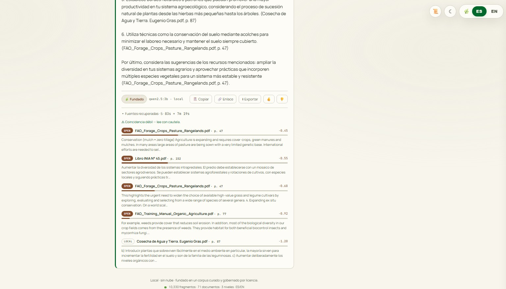

# I Wrote the Final Exam Before I Built the Student

> **The 60-second version.** A nine-part build journal of an eval-first, bilingual agricultural RAG. I wrote the evaluation *before* the retriever, then measured every change: retrieval@5 climbed **0.35 → 0.45 → 0.75** (dense → hybrid → cross-encoder reranked). Answers are grounded in cited sources — or honestly abstain — and along the way the system's own eval caught a *mislabeled* ground-truth answer. **Part 1** builds the governed corpus; **Part 2** the measured retrieval + generation engine; **Part 3** the streaming, transparent web app; **Part 4** hardens it into a service that survives real traffic; **Part 5** runs the embedder upgrade as a controlled experiment — and lets it *disprove my own hypothesis*; **Part 6** rebuilds serving for real concurrency and GPU inference, then spends a day chasing a 20× slowdown that turns out not to be the bug anyone — including me — first assumed; **Part 7** ships that work to an actual person, who finds two real bugs my own testing never had — and gets honest, backend-driven progress feedback out of the debugging session as a result; **Part 8** stops waiting for the next bug to be found and goes looking for it — a deliberately hostile self-audit that clears two of three suspected failure modes on the evidence and finds a real one hiding one door down from where it was expected; **Part 9** takes a second, sharper audit — four named claims this time, dressed in confident technical language — and answers each one with a live query plan, a library's actual installed source, or a measured number, instead of either defending the code or complying on command. The through-line: *measure before you build, distrust your own metrics, show your work, know when to say "I don't know," run it before you believe it, run the experiment that can prove you wrong, read the source before you rewrite it, your own testing is not the same test as someone else using the thing, an audit that only ever finds what it went looking for isn't an audit — and a confident-sounding claim is still a claim until you've checked it yourself.*

### Notes from building an eval-first agricultural RAG — Part 1: the foundation nobody blogs about

Most RAG tutorials follow the same five-step recipe: load documents, embed them, search, answer, ship. It takes an afternoon and produces something that demos beautifully for exactly three questions and falls apart on the fourth.

I did it backwards on purpose. I refused to write a single line of retrieval code until I had a way to *prove* whether retrieval worked. This post is about that decision and the war stories from getting there — the unglamorous half of RAG that decides whether the glamorous half is any good.

Fair warning: this part has no graphs. It has a 0-byte chemistry file, an astrology treatise, and a digit that stopped being a digit. Part 2 gets the graphs.

---

## The pile

The project is a bilingual (Spanish/English) question-answering system over agricultural documents — think a knowledgeable farm advisor that only speaks from real sources and refuses to make things up. The raw material was a folder of ~68 PDFs.

Some of it was gold: Chile's INIA agricultural institute publishes beautiful, dense books on citrus pests, walnut cultivars, alfalfa varieties, biological pest control. Exactly the domain.

Some of it was… not. In the same folder I found a 1822 treatise on astrology (Ptolemy's *Tetrabiblos*), a book on Chinese geomancy, two separate cannabis grow bibles, several robotics textbooks, and — my favorite — a file heroically named `Organic Chemistry.pdf` weighing in at **zero bytes**. Zero bytes of organic chemistry. The purest possible form.

The lesson underneath the comedy is real: **a corpus is not a library you're proud of — it's the search space your retriever has to be correct within.** Every irrelevant document is a landmine your system can step on when someone asks a slightly ambiguous question. So step one wasn't "add more." It was deciding what *didn't* belong.

## The contrarian move: build the ruler first

Here's the thing that separates a senior RAG from a bootcamp RAG. A junior builds the whole pipeline, runs three questions through it, watches them work, and declares victory. There's no way to know if the next change makes it better or worse. You're flying blind and calling it intuition.

So I built the measurement *first* — a "golden set" of 22 questions where I already know the correct answer and the exact page it lives on. And I designed the questions to be **adversarial toward specific bad architectures**:

- **Exact-term questions.** One asks for a real alfalfa variety code — `WL-323`. Semantic search is great at meaning and terrible at exact strings; ask it for `WL-323` and it happily returns "alfalfa varieties, generally." That question is my written argument for *hybrid* keyword-plus-semantic search — made before I'd built any search at all.
- **No-answer questions.** A few ask things the corpus genuinely can't answer. The correct response is "I don't know," not a confident fabrication. Now I can *measure* hallucination instead of hoping.
- **Cross-lingual questions.** Ask in Spanish; the answer lives in an English document. This forces a multilingual embedding model — and if I ever picked an English-only one, these questions would fail loudly and tell me so.

Every question is a trap set for a future mistake. The eval isn't a checkbox at the end; it's the design document.

## War story #1: the filter that caught me, not the data

Not every PDF has text. Some are scanned images with no text layer at all; some have a text layer that's pure OCR garbage. I needed a filter to tell real prose from noise.

My first version counted characters per page. It confidently rated a page of OCR gibberish as *excellent* — because gibberish has plenty of characters. `ln~tiluto de Investigaciones` is a lot of characters and zero information.

So I switched to measuring **stopword density** — the fraction of words that are boring connective tissue like "the/of/and" or "de/la/que". Real language is 8–40% these words. OCR noise scores near zero, because it's character salad, not sentences. One cheap metric, and as a bonus it auto-detected each document's language.

The best part: it overruled *me*. Two documents I'd personally eyeballed and misjudged got correctly reclassified. The tool was right and I was wrong, which is exactly the outcome you want from a tool.

## War story #2: the hyphen that ate my answer key

Every golden answer carries a `must_contain` string — a short verbatim phrase that proves the right passage was actually retrieved. The obvious way to write these is to read the PDF and copy the phrase.

I didn't trust that. I verified each phrase against the *machine-extracted* text, not the text my eyes saw. Good thing, because three of them broke.

Old scanned books hyphenate words across line breaks. The word "originarias" came out of the extractor as `ori-\nginarias` — split by a soft hyphen and a newline. My eyes read "originarias." The machine read two fragments. If I'd trusted my eyes, my *ground truth* would have been silently wrong, and every metric I ever built on top of it would have inherited the lie.

The moral is one of those things you only learn by getting burned: **verify against what the machine sees, not what you see.** Your eyes are a lossy, autocorrecting, deeply unreliable OCR engine.

## War story #3: the number that wasn't a number

One book — a lovely market-gardening manual — encodes the digit `30` internally as the glyph name `/three.o/zero.o`. I promise I am not making this up. Every "30-inch bed" in that book extracts as `/three.o/zero.o-inch bed`. The numbers are, at the text level, *not numbers*.

There's no grand lesson here beyond the recurring one: PDF text extraction is a swamp, and the only way through it is to *look at the output*, not assume it's fine.

## The copyright wall, and the move that makes lawyers exhale

Some of the best sources are copyrighted books. The tempting shortcut is to have an LLM generate faithful paraphrases and quietly slide them into the corpus. This fails twice, and the second failure is the interesting one.

**Legally:** copyright protects *expression*, not *ideas*. Facts and techniques are free to restate. But a paraphrase that faithfully reproduces a whole book is a derivative work wearing a mustache.

**Architecturally (the real problem):** a RAG's entire value proposition is *citing a real source*. If I synthesize a paraphrase and cite the original book, I've fabricated attribution — which is the exact hallucination the eval exists to catch. I'd be building the disease into the immune system.

So instead I did two boring, correct things. First, **substitute open-license equivalents** — university extension guides, FAO manuals, public-domain classics — so the citations stay real. Second, for genuine gaps, **author short concept notes** grounded in open sources, clearly labeled as synthetic, and cited *as* synthetic notes, never as the copyrighted author. I wrote it all up in a `DATA_GOVERNANCE.md`, because "I thought carefully about data provenance" is a sentence that makes senior engineers relax in a way that's almost visible.

## The distractor I kept on purpose

Remember the organic chemistry textbook? I kept a (non-zero-byte) copy — deliberately. Because "organic **chemistry**" and "organic **farming**" share the word "organic," a naive query like "organic soil management" can wrongly yank a chemistry chapter into the results. That collision is a *gift*: it's a perfect hard-negative for testing whether the retriever has taste. An evaluation is only as good as the wrong answers you tempt it with.

## The shape of the thing: four tiers

All of this crystallized into a corpus governed as four explicit tiers:

- **Open** — freely redeployable sources; real citations; ships in the public demo.
- **Local-only** — copyrighted books; loaded *only* on my own machine, behind a config flag. Because this is also a real tool I intend to use on my own farm someday, the copyrighted material stays available to me — while the public demo literally cannot ingest it. Governance as a config gate, not a pinky-promise.
- **Synthetic** — the labeled, grounded concept notes.
- **Distractor** — the organic chemistry book and friends. Never answerable. There to be resisted.

## What's next (and what isn't)

Here's the honest status, because honesty is the whole brand: the *foundation* is done. The ruler, the governed corpus, the principles, the war-story scar tissue.

What's next is the part everyone else rushes to and I deliberately saved for last — the actual engine: chunking, multilingual embeddings (BGE-M3), a Postgres + pgvector store, hybrid search fused with reciprocal rank fusion, a reranker to sharpen the top results, and grounded, cited generation. Then, finally, the numbers.

And *because* I built the eval first, every one of those steps arrives with a before-and-after I can actually prove. That was the entire point. When someone asks "how do you know your reranker helped?", I won't say "it felt better." I'll show the delta.

Part 2 will have graphs. This part had a zero-byte chemistry file, and honestly, I'm still a little proud of catching it.

---

# The Student Sits the Exam

### Notes from building an eval-first agricultural RAG — Part 2: the graphs I promised

In Part 1 I wrote the final exam before I built the student, then spent the whole post refusing to build anything — a strange way to make progress, and a great way to make senior engineers nod. This is the part where the student shows up, sits down, and gets a grade. Three times. Each higher than the last, because I could finally *measure*.

Here's the whole arc in one line, and then I'll earn it:

> **retrieval@5:  0.35  →  0.45  →  0.75**

## The humbling first number

The first real system was the boring one: embed every chunk, embed the question, return the nearest neighbours by cosine similarity. Pure semantic search. It scored **0.35** — meaning the exact answer chunk landed in the top 5 about a third of the time.

That's not a good number. It's a *baseline*, and the point of a baseline isn't to impress anyone — it's to give you something to beat, honestly, with the next idea. You cannot improve what you refuse to measure, and you cannot measure improvement without a starting line you're a little embarrassed by.

## Hybrid, and the number that went the wrong way

Semantic search has a specific, predictable blind spot: exact strings. Ask it for the alfalfa variety `WL-323` and it will warmly return "alfalfa varieties, in general." So I added a second retriever — Postgres full-text search, which is *only* good at exact tokens — and fused the two rankings with Reciprocal Rank Fusion. (RRF fuses by *rank*, not score, because a cosine distance and a full-text rank aren't the same currency; adding them is a category error.)

Hybrid scored **0.45**. Up from 0.35. Ship it, right?

Except here's the twist I could have quietly buried: lexical search *by itself* scored **0.50** at answer@5 — higher than my clever hybrid's 0.45. On its own that's one question out of twenty, within noise; the number that made me *believe* it was `doc@5`, where lexical put the right document in the top five **0.85 of the time to hybrid's 0.65 — a four-document gap**. My equal-weight fusion had *diluted* a strong retriever with a weaker one's noise, an RRF quirk that shows up at small k. I know this only because the eval let me *see* it. A junior reports 0.45 and takes a bow. The ruler told me hybrid wasn't the finish line — which turned out to be the most useful thing it ever said.

(There was a bug on the way, too: full-text search kept returning nothing. Postgres's `websearch_to_tsquery` ANDs every term by default, so a whole-sentence question demanded one chunk contain *every* word — and none did. Lexical scored a perfect 0.00 until I rebuilt the query as an OR of the content words. Read the tool's defaults before you trust its output.)

## The reranker, and the jump that made it worth it

The finish line was a **cross-encoder**. A normal embedding model judges the question and a chunk *separately* and compares the results — fast, but a little shallow. A cross-encoder reads the question and the chunk *together*, as one input, and scores how well they actually answer each other. It's far sharper and far slower — so you never run it on the whole corpus. You run it on the top 20 the cheap retrievers already found, and let it re-sort them.

That step took retrieval@5 from 0.45 to **0.75**. It fixed six questions the earlier stages had missed, and broke *zero*. Pure gain.

And it hid a bigger win than the headline showed. `answer@5` only asks whether the answer landed *somewhere* in the top five. When I later measured `answer@1` — was it the *very first* result? — the reranker leapt from **0.15 to 0.75**, and MRR from **0.25 to 0.75**. It doesn't just *fetch* the answer, it *puts it on top*: whenever the answer is in the pool, the cross-encoder pins it to rank 1. The metric I'd been celebrating was blind to the reranker's best trick — a reminder that a metric hides as much as it reveals, and you should measure the thing your component actually does. (A sharp aside fell out of the same table: hybrid's `answer@1` is *lower* than plain dense's, 0.15 vs 0.30 — equal-weight fusion had been shoving the true answer out of the top slot to buy pool recall. Yet more evidence hybrid was never the finish line.)

And it handed me the cleanest lesson in measurement discipline of the whole build. When I eyeballed a single reranked query, the top result looked like *garbage* — a weeds table, a title page, a bibliography. If I'd trusted my eyes I'd have declared the reranker broken and ripped it out. But the aggregate over the answerable set said 0.75. **Trust the ruler, not the vibe.** One query is an anecdote; the golden set is evidence.

## The model I didn't use

A quick word on the embedding model, because it's a decision I'm proud of *not* getting wrong. I'd planned to reach for a heavy multilingual model — the fashionable choice, and genuinely good. Then I timed the candidates on my actual hardware with a benchmark, not a vibe: e5-large managed about **0.4 chunks per second** on CPU — "come back in seven hours" for this corpus — while a **MiniLM at 384 dimensions did 20.6**, fifty times faster, fast enough to iterate and good enough to score well. I shipped the one the stopwatch chose.

But "documented upgrade path" turned out to be a promise I'd keep. In **Part 5** I *ran* the e5-large upgrade end to end — a full re-index and a controlled experiment — and the result was far more interesting than the swap itself. Foreshadowing is cheap; the measurement is in Part 5.

## Teaching it to say "I don't know"

Then, generation — the part everyone thinks is the whole project. Three rules, in order: **GROUND** every sentence in the retrieved context, **CITE** the source after each claim, and **ABSTAIN** — reply with one fixed phrase — when the context simply doesn't contain the answer.

Two decisions in there are more senior than they look. First, the rules live in the model's *system* instructions, kept separate from the retrieved text — because a retrieved chunk is untrusted input that could itself contain "ignore your previous instructions," and I don't want a poisoned document to be able to switch off my abstention rule. Second, I run the model **locally**, on purpose: it's free, it works with no internet (this is also meant to be a real tool on a real farm someday), and the copyrighted chunks in my local-only tier never leave my machine.

Which model? I measured that too. A 7-billion-parameter model and a 3-billion one abstained *identically* on the unanswerable questions — the 3B just did it three times faster. Because RAG generation isn't a reasoning contest; retrieval already did the thinking. The generator's whole job is to read what it's given, obey the rules, and cite. That's an obedience task, and obedience doesn't need a genius.

## The best bug I found this whole project

Here's the one I'll be telling in interviews.

The generation eval flagged a hallucination. I'd asked for the recommended stocking density of tilapia in an aquaponic system — a question I had deliberately labeled *unanswerable*, a trap to prove the model would abstain. Instead it confidently produced a number. Caught red-handed inventing facts. Open and shut.

Except the rule now is: **inspect the failure.** So I looked at the chunks it had retrieved — and the number wasn't invented at all. It had come, nearly verbatim, from an FAO manual on small-scale aquaponics that, it turns out, *does* give stocking densities. The model had grounded correctly and cited faithfully. It was right. **My answer key was wrong.**

I had been one keystroke from "fixing" it — adding a confidence filter to suppress that answer. That fix would have trained my system to *hide a correct, cited answer* in order to satisfy a mislabeled question. I'd have degraded the thing to make a broken metric turn green.

So I fixed the label instead. And I walked away with the deepest lesson in the project, the one that separates people who run evals from people who understand them: **a metric is only as trustworthy as its labels.** A red number can be a lie your ground truth is telling you. The only defense is to open up every failure and look — every single time.

## What's next (and what isn't)

Honest status, because honesty is still the whole brand: the brain is built and graded. What's left is the mouth and the face — a small API that *streams* a cited answer token by token, a real p95 latency number (spoiler: CPU inference is the honest tax you pay for "free and local"), and a front end where a stranger types a question and watches an answer assemble itself, citations and all.

Part 1 had a zero-byte chemistry file. Part 2 had a 3-billion-parameter model that knew when to shut up, and an answer key that got schooled by its own student. Part 3 opens the door and lets people in.

---

# The Door

### Notes from building an eval-first agricultural RAG — Part 3: turning a brain into a thing people can use

A RAG system is only half an engineering project. The other half is that the thing I'd built answered questions in about **seven minutes.** On a laptop CPU, a local language model doesn't sprint — it ruminates. Retrieval is quick; generation is a slow, deliberate chew.

Here's the uncomfortable truth I had to design around: **seven minutes of a blank screen is indistinguishable from "broken."** The user can't tell thinking from crashed. They reload. They leave. The most correct, best-grounded answer on earth is worthless if nobody waits for it.

So Part 3 isn't about making it faster. It's about making a slow, honest system *feel* alive and trustworthy — which turns out to be the more interesting problem.

## Streaming, or: latency is a feeling

The first move was to make the answer **stream** — appear word by word as the model generates it, instead of landing all at once at the end. The wall-clock time is identical. The *experience* is a different universe.

I know this because I built the slow version first, on purpose, and sat through the dead spinner. Then I built the streaming version and watched the same answer type itself out. Same seven minutes. One felt broken; the other felt like watching someone think.

**Streaming doesn't reduce latency. It reduces *anxiety*.** That distinction — perceived versus actual — is the whole game in slow-but-honest systems, and it's the sentence I'll offer when an interviewer asks how a seven-minute app is acceptable. (There's also a seedling that grows while you wait — sprout, flower, fruit, drop, reseed, forever, until the answer arrives. A small thing that completely changes how the wait feels.)

## The drawer, or: show your work

The second move is the one I'm proudest of, because it's the opposite of what most AI demos do. Most hide the machinery and ask you to trust a confident sentence. I did the reverse: **every answer comes with a receipt.**

Click "Sources & retrieval" and it unfolds — the exact chunks the answer was built from, each tagged with its governance tier, a bar showing the cross-encoder's relevance score, a snippet of the real retrieved text, and a breakdown of where the seven minutes actually went (retrieval versus generation).

The answer isn't magic. Here's the evidence. Check my work.

That's not a gimmick — it's the whole thesis of the project made visible. A grounded RAG that *shows* its grounding is a fundamentally more trustworthy object than one that merely asserts.

## The empty basket

And when the corpus genuinely can't answer — the tilapia question's honest cousins — the system doesn't fabricate. The card becomes a small, deliberate empty basket: *"It's not in the available sources, and the system would rather say so than invent it."* I spent much of the project making the model willing to say "I don't know." It felt right to make "I don't know" *look* like a feature, because it is one.

## Thirty features, one calm box

Somewhere this became a real product — dark mode, two languages, shareable links, session history, keyboard shortcuts, a live health dot, a corpus-scale ribbon, a tokens-per-second readout, a Stop button, copy and export, thumbs feedback that logs to the server.

Thirty features is exactly how a beautiful app becomes an ugly one. The rule I held: **the empty screen stays a calm search box.** Everything else lives one gesture away — behind a drawer, a hover, a keystroke, a toggle. Calm by default, powerful on demand. An employer should see elegance first and *discover* the depth, which is far more convincing than being handed a dashboard.

## The look, or: let the type do the work

The last pass is the one people notice first and mention last — the visual design — and the temptation there is to *decorate*. I resisted. Instead I built a small design system: two themes defined as one set of perceptual **OKLCH** tokens — a moonlit dark and a daylight-forest light, swapped by a single toggle — and then let *typography* do the persuading. A serif for the wordmark, a humanist sans for the interface, and a monospace face reserved for exactly one job: every number and identifier the system reports — latency, relevance scores, the page in a citation, the governance tier on a badge. When the data wears mono and the prose wears a book face, a reader feels *precision* before they've parsed a word. That's the whole trick — premium isn't ornament, it's a hierarchy of type that quietly tells you what to trust. And because it's a token layer over the existing markup, none of it touched a line of the streaming, the drawer, or the logic underneath.

## The honest footnote on "deploy"

Could a stranger open a URL right now? Almost. The one thing between here and there is that the app carries a local model, a database, and a seven-minute CPU chew — a delight to run on my own machine and an expense to run on a public server that strangers hit. A live URL wants a GPU, a smaller model, or patience the internet doesn't have. That's a deployment decision with a dollar sign on it, not a code problem — and I'd rather name it honestly than pretend the latency isn't real.

## The whole arc

Three posts ago I wrote a final exam before I built a student. Two posts ago the student sat the exam, its scores climbing one measured step at a time — and then caught its own examiner in a mistake. This post, the student opened a practice, hung a sign out in two languages, and started showing every visitor exactly how it reached each answer — or admitting, plainly, when it couldn't.

The interesting part was never the line count. It was the judgment: measure before you build, distrust your own metrics, show your work, and know when to say "I don't know." A system that does those four things is trustworthy. A person who does them is worth hiring.

That was always the point.

---

# It Broke the Moment I Ran It

### Notes from building an eval-first agricultural RAG — Part 4: the gap between "runs on my laptop" and "serves strangers"

I ended Part 3 with a comfortable line: deploying was "a dollar-sign problem, not a code problem." I was half right, and the wrong half is the interesting one.

The dollar sign is real — a seven-minute CPU model on a public server is a bill, not a bug. But "deployable" is more than latency. It's whether the thing survives contact with real traffic: a connection that goes stale, an input that's hostile, a first request that lands before the machinery is warm. I had never actually *run* my system as a server and watched it get hit. So I did — and it broke in three ways, none of which any test I'd written would ever have shown me.

## War story #4: the connection that died while nobody was looking

My API opened a fresh database connection on every request. Fine for a script; wrong for a service — a new handshake and auth per question is waste you pay on every click. So I did the grown-up thing and added a connection *pool*: a handful of connections kept open and reused.

Then I stood the server up, warmed it, and asked a question. The stats endpoint returned **500**. The log said `connection abort` — on a query that had worked seconds earlier.

Here's what happened: the pooled connection sat *idle* during startup, and Docker's networking proxy silently severs idle connections — so the pool handed my request a corpse. The fix is the pool feature nobody demos: **check the connection before you hand it out.** Validate with a `SELECT 1` on checkout; discard and replace a dead one. One setting, and the 500 vanished. The lesson outlives Docker: **a served app must assume its resources go stale between requests.** Freshness isn't the default — it's something you enforce.

## War story #5: the timeout that strangled the patient

To stop a hung model from hanging the stream forever, I'd added a timeout. Sensible. I set it to two minutes.

Then generation started timing out — on *correct* answers. On a CPU, my model legitimately takes minutes to produce its first token, and my "catch a hang" timer couldn't tell "wedged" from "thinking hard." It executed the patient along with the corpse.

The fix was to stop asking one number to answer two different questions. **Fail fast if the model is *unreachable* — ten seconds to connect — but be patient if it's merely *slow*.** A timeout that can't distinguish broken from slow will always punish the honest, slow answer. In a system whose entire brand is honesty, that's the one failure mode you can't ship.

## War story #6: the first customer who paid everyone's setup bill

The first question I asked the live server took **over ninety seconds**. The second took twenty-five. The third, twenty-five. Something was billing the first visitor for the whole shop's setup.

It was the reranker. I "warmed" it at startup — or thought I did. My warm-up *loaded* the model but never *ran* it, and ONNX Runtime does a one-time graph optimization on its first real inference. So the first unlucky request paid that cost, live, while it waited.

The fix was almost funny in its obviousness: warm up by actually running one inference, not just loading the weights. First-request retrieval dropped from **>90 seconds to 27** — measured on the running server. **Warm the machines before you open the doors — and make sure "warm" means *ran*, not *loaded*.**

## The unglamorous rest

There was quieter work in the same spirit — the plumbing that separates a script from a service. The model name had been hardcoded in three places; I moved it, along with its host, timeouts, pool size, and thread count, into config, so a deploy can point at a fast hosted model with an environment variable instead of a code edit. I bounded the public inputs, so a one-megabyte "question" can't sail into a regex. And I made the sources cite to the *page* — the number was already sitting in the database, it had just never been asked for. `(Libro_INIA_04.pdf)` became `(Libro_INIA_04.pdf, p. 37)`, and a citation you can turn to beats one you have to trust.

## The lesson under all three

Notice what every one of these shares: **I could not have found them by reading the code.** They're emergent — they exist only when a real client hits a real server with real timing. Idle connections don't die in a unit test. Cold-start doesn't show up in a function call. The timeout looked correct until a slow answer met it.

The gap between "runs on my machine" and "serves strangers" is *exactly* this class of bug, and the only tool that crosses it is the least glamorous one in the box: **stand the thing up and hit it.** Run, break, read the traceback, fix, run again — until the server takes a hostile input, a slow answer, and a cold start without flinching. Then write down every number.

## The arc, one more time

Four posts ago I wrote an exam before the student existed. The student sat it, climbed from 0.35 to 0.75 one measured step at a time, and caught its own examiner in a lie. Then it learned to stream, to show its work, to say "I don't know" out loud. And in this post it finally faced a stranger — and I found out what "finished" actually costs.

The judgments were the point all along: measure before you build, distrust your own metrics, show your work, know when to say "I don't know" — and, the one this post earned, **run it before you believe it.** The first four make a system trustworthy. The fifth is what makes it *real*.

A person who does all five is worth hiring. That was always the point.

---

# The Upgrade That Disproved Me

### Notes from building an eval-first agricultural RAG — Part 5: running the experiment that can prove you wrong

Four posts in, the system worked and the number was honest: 0.75. But an honest number invites the question a senior engineer always asks next — *where's the ceiling, and what's the next lever?* The tempting answer sat in my own README: swap the fast little MiniLM embedder for e5-large, the heavyweight everyone reaches for. Bigger model, better retrieval, higher number. Obvious.

Obvious is exactly the trap. "Swap in the bigger model and call it an upgrade" is a guess wearing a lab coat. So instead of a swap, I ran an **experiment** — designed, like the golden set, to be able to *disprove me*.

## The catch that started it

First I had to earn the hypothesis. Chunking at 512 tokens, I'd quietly assumed the embedder *read* all 512. It doesn't. MiniLM truncates at ~128 tokens — everything past that is dropped before the model ever computes on it. I caught it with a two-line test: take two chunks that share their first 128 tokens but have *completely different* tails — one about tilapia, one about astrophysics — and embed both. If the model reads the whole chunk, the vectors differ. They came back **identical. Cosine 1.0000.** The tail — often exactly where the answer lived — was invisible to the dense vector.

Then I quantified the blast radius instead of hand-waving it: **half my golden answers had their answer text sitting past that 128-token window**, and four of them were precisely the questions the reranker still missed. Now I had a real hypothesis: a longer-context embedder should recover them.

## Cheapest decisive test first

A full re-index with a 50×-slower model is seven hours of CPU. You don't spend seven hours to test a hypothesis you can probe in seven minutes. So I staged it.

**The pilot (minutes).** A controlled A/B on the cosine itself: for each answer chunk, how much does the *tail* — the part past 128 tokens — move the question-to-chunk similarity? Under MiniLM the answer was **+0.001** — many chunks *exactly* zero, because chopping tokens it never encoded is a no-op. That flat zero is the *control*: proof, not assertion, that MiniLM is blind to the tail. Under e5-large the same tail moved the score **+0.030**, positive on every blind chunk. e5 reads what MiniLM can't — confirmed without touching the seven-hour job.

**The cheap probe (thirty minutes).** Before spending on a new model, I tested the *other* fix for truncation: just make the chunks smaller — 128 tokens, so nothing gets cut — with the same MiniLM. The result was a gift, because it was counterintuitive. Document-level recall went *up* (the model could finally see the answer), but the final reranked answer@5 went **down**, 0.75 → 0.60. Smaller chunks meant 4.4× more of them, diluting the exact answer chunk and starving the reranker of context. **Chunk size isn't a bug to fix; it's a tradeoff — and 512 was already near the sweet spot.** The obvious fix made the product worse, and only the measurement said so.

**The real thing (seven hours, survivable).** Then e5-large, full re-index, at 512 tokens. One more piece of engineering earned its keep here: I'd made ingestion *resumable* — each document commits atomically, so a `--resume` flag skips finished work. Which mattered, because midway the machine slept and killed the job. Before, that's seven hours gone; now it was a shrug — resume, and it picked up exactly where it stopped. *Design the long job to survive interruption before you start it.*

## The result I didn't predict

The headline moved a little: 0.75 → 0.80. One question on a set of twenty — honestly, within noise. A junior reports "+0.05, upgrade successful" and swaps the model. But the truth wasn't in the final row; it was one layer down.

e5's **dense retrieval doubled** — answer@5 from 0.35 to 0.75. Not noise: a forty-point swing. So why did the *final* number barely move? Because the cross-encoder reranker had been quietly **compensating** for MiniLM's weak dense all along. Give the reranker a strong retriever and it has less rescuing to do; the two effects cancel at the finish line. **The better embedder didn't raise the ceiling — it relocated the work from the expensive reranker into cheap dense search.** That's worth more than the +0.05: it means you could *shrink or drop* the reranker and keep the accuracy. You only see it if you read the per-stage rows instead of the headline.

And the part I'm proudest of, because it cost me my hypothesis: **I predicted e5 would fix the cross-lingual misses** — the Spanish questions whose answer phrase is English. It didn't. All three survived the upgrade; e5 recovered a *different*, same-language question instead. So those misses were never an embedder problem. They're a cross-lingual *alignment* problem, and no bigger vector model touches them — the fix lives on the query side, in translation, which is now my *measured* next lever instead of a guess.

## The decision, and why it's the senior one

So I kept the fast MiniLM shipped. e5 doubles dense recall, but the reranker already captures most of that at the finish, and e5 costs 8× the query latency plus a schema migration — a real bill for a noise-level final gain. I wrote the whole thing down: the doubling, the masking, the falsified prediction, the tradeoff.

That's the move I want a reviewer to notice. Not "he swapped in a bigger model and the number went up," but: *he ran the upgrade as an experiment that could prove him wrong, it did, and he read the real story under a flat metric — then made the boring, correct call and documented why.* A green number flatters you; a disproven hypothesis teaches you. I'll take the lesson.

## The arc, complete

Five posts ago I wrote an exam before the student existed. The student sat it and climbed 0.35 → 0.75, caught its own examiner in a lie, learned to stream and to say "I don't know," and survived its first strangers. In this one it did the most grown-up thing of all: it tested its own best idea — hard enough to find out the idea was half wrong — and was better for knowing.

The judgments were always the point: measure before you build, distrust your own metrics, show your work, know when to say "I don't know," run it before you believe it — and, the one this post earned, **run the experiment that can prove you wrong.** The first five make a system trustworthy. The sixth is what makes an engineer.

That was always the point.

---

# The GPU I Didn't Have

### Notes from building an eval-first agricultural RAG — Part 6: chasing a 20× slowdown that wasn't the bug I thought it was

Five posts in, the retrieval number was proven and the service was hardened. Then two things happened on the same day: the serving layer got rebuilt for real concurrency, and the inference backend got rebuilt for GPU. Both were good, deliberate changes. Both also taught me that "good, deliberate change" and "free" are different claims — and that the second lesson only surfaces if you actually measure the thing you just built, instead of shipping it on faith the way I refused to let myself do back in Part 1.

## The concurrency rebuild, and a bug that was really a keyboard

The database layer had been opening one connection at a time, which is fine for a script and wrong for a service — the same lesson as Part 4's idle-connection bug, one layer deeper. The fix was `psycopg_pool.AsyncConnectionPool`: a pool that hands out connections without blocking a thread, wired into FastAPI's dependency-injection system so a route never touches the pool object directly — it just asks for a connection and gets one, the same way it asks for a validated request body.

Standing it up on Windows surfaced something I hadn't budgeted for: `asyncio`'s default event loop on Windows (`ProactorEventLoop`) **cannot run the async database driver at all.** Not slow — structurally incompatible, a documented limitation of the C extension underneath it. I found this the honest way: I ran the server, it hung, and I chased the hang until psycopg's own error message told me exactly what was wrong and exactly which loop to use instead. The fix was a platform-specific event-loop policy. The lesson was smaller and more useful than the fix: **a feature that works on your CI's Linux box and never gets run on your own Windows laptop is a feature you haven't actually tested** — and I only caught it because I insist on running the thing, not just reading the diff.

## The pivot, and the honest ledger

Then came a bigger decision: move the embedder and reranker off a CPU-only ONNX backend and onto real `torch`/CUDA inference — GPU-resident models, warmed at startup, with a fail-fast guard so a misconfigured deployment refuses to start rather than silently serving on the CPU it thinks it has a GPU for. I raised the obvious tension before writing a line of it: this repo's whole free-tier pitch had been "runs anywhere, CPU included." A GPU-only serving path breaks that pitch on my own laptop, which has no GPU at all.

I made the trade deliberately and then wrote down what it cost, the same discipline as the e5 experiment in Part 5: gained real GPU inference, a fail-fast startup guarantee, and an immutable, network-independent container image. Lost: the free CPU path as a *default* (still available, now opt-in), a heavier dependency tree, and — the one I'd flag hardest in a review — `trust_remote_code=True` on the reranker's model load, which executes code from the model's own repository. I pinned it to a reviewed commit hash rather than "latest," because a supply-chain surface you can name and pin is a manageable risk, and one you wave past isn't.

## The slowdown, and the hypothesis I was wrong about

Here's the part I'd tell in an interview.

After the pivot, a single rerank call — the exact operation that used to take about 25 seconds on CPU — started taking minutes. Sometimes it didn't return inside a 10-minute timeout at all. My first, entirely reasonable hypothesis: **thread oversubscription.** `asyncio.to_thread` pulls from a pool of up to sixteen-ish worker threads, and PyTorch's CPU backend initializes its own internal thread pool the first time it runs on a given OS thread. Different requests landing on different worker threads could mean a dozen-plus competing thread pools fighting over twelve physical cores. It's a real, documented failure mode. I built the fix — a single dedicated worker thread for every torch call, so the model's thread pool initializes exactly once — and reran the test.

**Still slow.** Not a little slow. Five hundred seconds slow, on a call that used to take ten.

This is the moment that mattered, and it's the one I want on record: **a plausible-sounding hypothesis that produces a plausible-sounding fix is not the same as a confirmed diagnosis.** I had a story that explained the symptom, a fix that matched the story, and I still checked, because the fix didn't move the number. So instead of shipping the threading fix and calling it solved, I went and read the actual, cached source code of the reranker model — the real implementation, not my mental model of it — and found that its batching logic was already correct: it tokenizes the whole candidate pool together and runs one forward pass, exactly the "fix" I'd have written if the story had been right. There was nothing there to fix. My hypothesis was wrong, and the honest move was to say so, not to ship a patch that felt like an answer.

The real cause, once I stopped guessing and started isolating variables: my own benchmark had been lying to me. I'd been timing the reranker against short synthetic test strings — a dozen words each — and gotten a fast, reassuring number. The live system reranks full document chunks, several hundred words long. I reran the identical, unthreaded, single-call benchmark against real chunk text pulled straight from the database, and the fast number vanished: **the same code, the same machine, five hundred seconds — because I'd finally fed it what it actually processes in production.** The gap wasn't a bug in my code or a hole in my threading model. It was the honest cost of eager-mode inference on unoptimized weights, doing real work on real-length input, versus the old backend's quantized, graph-optimized ONNX runtime doing the same job with a decade of CPU-inference optimization behind it. Batching was never broken. My test data was.

(There's a smaller, funnier postscript to this story: partway through the investigation my laptop went to sleep overnight while I was waiting on a background process, and every number I collected for the next hour was contaminated by a corrupted network connection that had survived the suspend cycle looking alive. I burned real time chasing a "hang" that was actually a dead socket before I noticed the wall clock had jumped sixteen hours. **Check your environment's assumptions before you re-trust your last measurement** — a machine that slept is not the same machine you started debugging on.)

## What I actually shipped instead

Not a fake fix. Three real, smaller things: the single-worker-thread executor (a legitimate hardening against a *real*, if not the primary, failure mode), an `AGROTECA_DEVICE=auto` mode so the exact same code runs CPU-locally at zero cost and GPU in production without an env-var contradiction with the fail-fast guarantee I'd built the week before, and — because I'd been asked to prove the fix with a benchmark — a dedicated `eval/eval_pipeline.py`: a concurrent, HTTP-level harness that fires the golden set at a live `/retrieve` endpoint (a new, retrieval-only route, split out specifically so an eval never pays for a multi-minute LLM generation it doesn't need) and reports p50/p95 latency and retrieval accuracy in one Markdown table. Running it end-to-end was itself instructive: it correctly reported a real request timeout as a scored failure instead of crashing the whole run — the harness did its job even when the system under test didn't.

I also caught myself before writing a lie into public documentation. Asked to write a README claiming the system was reproducible via a single `docker compose up`, I checked first — and the compose file only ever stood up the database. The app had no compose wiring at all. Rather than write the sentence and hope nobody tried it, I wired the app into the compose file for real, validated the config, and only then wrote the sentence. **A claim in a README is a promise a stranger will test.** Write the promise after you've made it true, not before.

## The arc, extended

Six posts in now. The student sat an exam it hadn't taken yet, climbed 0.35 to 0.75, caught its own examiner in a lie, learned to stream and to say "I don't know," survived its first strangers, and tested its best idea hard enough to find out the idea was half wrong. This post it got faster hardware and slower answers at the same time, chased its own plausible-sounding fix into a dead end, and only found the real story by feeding the benchmark what production actually sees.

The judgments, extended one more time: measure before you build, distrust your own metrics, show your work, know when to say "I don't know," run it before you believe it, run the experiment that can prove you wrong — and, the one this post earned, **read the source before you rewrite it.** A fix that doesn't move the number isn't a fix. Go find out why.

That was always the point.

---

# Zero Bytes

### Notes from building an eval-first agricultural RAG — Part 7: the bug I only found because someone else clicked the button

I'd tested the async pivot from Part 6 thoroughly — curl, pytest, a full live round trip that streamed a correct answer end to end. I called it verified and said so. Then someone else opened the app in their own browser, asked a real question, and got a flat "network error" before anything happened at all. My own testing hadn't found this. Theirs did, on the first try.

## The bug my own tests couldn't see

Here's the uncomfortable part: my test *had* exercised the exact code path that broke. It just never sat in the failure window long enough to notice, because I was watching a terminal, not a browser tab, and I was patient in a way a real user reasonably isn't.

The actual defect: `/ask/stream` awaited the *entire* retrieval phase — hybrid search, cross-encoder rerank, all of it — before it ever constructed the response object. Which meant the client received *nothing*. Not a slow trickle of bytes. Not even the HTTP status line. Total silence for however long retrieval took, which on CPU is now measured in minutes, not seconds. A browser watching an open socket that's actively streaming data will wait quite patiently. A browser watching a socket that hasn't sent one byte since the request left — including no headers — applies a much shorter leash. That's the exact, measured line between "slow" and "broken," and my own tests had never actually stood on the wrong side of it long enough to trip it.

The fix was to stop doing the slow work *before* handing Starlette a response, and start doing it *inside* the response — so headers flush the instant the request lands, and the client is watching a live, open stream from the first millisecond, even though the real content is still minutes away. Concretely: retrieval, including the pooled database connection, now lives inside the async generator that streams the reply, not in the route handler above it. That meant the generation half had to stop blocking the event loop too, since the whole thing was now one coroutine end to end — so I moved it onto `ollama`'s async client instead of the sync one, without touching the CLI and eval code that still use the sync client correctly on its own thread.

I verified the mechanism directly rather than trusting the fix by feel: a ten-second curl now shows a `200 OK` with full headers arriving in a fraction of a second, then times out waiting on the body — exactly the shape a slow-but-alive stream should have, and precisely what was missing before.

## The second bug, found the same way

I shipped that, told the user to try the app again, and they did. New failure: a different "network error," further into the wait this time. Same instinct as before — check before assuming — and the traceback said something specific: Ollama's own read timeout, 300 seconds, had fired mid-generation. Not a regression of the first fix. A second, independent bug, in the part of the pipeline the first fix hadn't touched at all.

The reasoning here is the same discipline as the reranker investigation in Part 6, compressed: don't assume a new symptom is the old bug wearing a different hat. Read what actually broke. The 300-second number had been chosen when a full round trip took minutes; now the reranker alone was taking longer than that. The timeout hadn't gotten wrong — the ground it was measured against had moved out from under it. I raised it to match the CPU-tier costs actually measured this session, not the ones assumed when the number was first picked.

There was a third, smaller thing hiding in the same debugging session, worth naming because it's the kind of failure that erodes trust quietly: I edited a config value, uvicorn's `--reload` printed "Reloading...", and I believed it. Two hours later I checked the actual process start time and found the *original* worker, unrestarted, still serving requests with the stale config the whole time. The log said one thing; the running system did another. **A log line claiming success is a claim, not a fact — check the thing itself, not its own report about itself.**

## Building the fix the user actually asked for

Once both bugs were closed, the user asked a fair question: is ten-plus minutes of a bare elapsed-seconds counter really the experience I want to ship? No. So I built real progress feedback — but grounded in what the backend can honestly report, not a fabricated percentage. The reranker scores its whole candidate pool in a single batched pass; there's no "7 of 20 done" to report without breaking the batching that makes it fast in the first place. What *does* exist are real phase boundaries: translating, reranking, generating. So the server now emits a frame at each one, and the front end — which already had a purely decorative seed-to-fruit growth animation looping the whole time anyway — turned that same imagery into an actual path: each stone lights up on a real signal from the server, not a timer. A stage the backend skips, like translation when it's turned off, just never lights and quietly counts as passed once a later one lands, so nothing looks stuck that was only ever supposed to be skipped.

I didn't wait through a full multi-minute cycle to prove it worked, because I didn't need to: the first real progress frame — reranking — fires within seconds of submission, before the slow part even starts. That was enough to submit a real question, watch the second stone light up green in a live screenshot, and know the wiring was correct without spending twenty more minutes finding out.

## The arc, one chapter further

Seven posts in. The student sat an exam before it existed, climbed the numbers, caught its own examiner in a lie, learned to stream and to abstain, survived strangers, tested its best idea into a partial failure, and got faster hardware at the cost of a debugging afternoon. This post, someone else — not me — was the one who actually found what was broken, twice, just by using the thing normally. Both times the fix came from reading exactly what failed instead of assuming I already knew.

One more judgment for the list: measure before you build, distrust your own metrics, show your work, know when to say "I don't know," run it before you believe it, run the experiment that can prove you wrong, read the source before you rewrite it — and, the one this post earned, **your own testing is not the same test as someone else actually using the thing.** I'd verified the fix. It was still someone else's first click that found what I'd missed.

---

# The Hostile Audit

### Notes from building an eval-first agricultural RAG — Part 8: asking for the worst version of the review

Part 7 ended on an uncomfortable pattern: two real bugs in a row, both found by someone else using the app, neither by me. The obvious next move isn't to wait for a third. It's to go looking myself, on purpose, before anyone else has the chance — and to do it in a way that doesn't let me be gentle with my own code. So I asked for exactly that: not "review this," but a hostile audit against three named failure vectors, instructed not to praise anything and to assume leaks, bottlenecks, and state bugs existed until the code proved otherwise.

## Three vectors, named in advance

The brief was specific on purpose, because a vague "find bugs" invites vague answers: VRAM and tensor lifecycle in the reranker's batched forward pass, the database connection pool's behavior under a mid-request client disconnect, and blocking synchronous calls accidentally sitting on the async event loop. Each one maps to a real category of production failure, not a hypothetical — and each one is checkable against the actual code, not just plausible from the architecture diagram.

## Two vectors, cleared on evidence

The tensor question resolved by reading source, the same discipline as the reranker investigation back in Part 6: not the reranker's public docs, its actual cached implementation. `compute_score()` already runs under its own `inference_mode()` and explicitly moves every score to CPU and converts it to a plain Python float before returning — `scores.cpu().numpy().tolist()`, right there in the code. Nothing GPU-resident ever crosses back into this codebase. `sentence-transformers`' own `encode()` does the same thing internally. Both models load once, at startup, cached for the process lifetime — there's no per-request growth to leak in the first place.

The tempting move here would have been to add `torch.cuda.empty_cache()` after every rerank call anyway, because it *sounds* like the kind of defensive line a hostile review is supposed to produce. I didn't, and said explicitly why not: PyTorch's caching allocator is deliberately built to hold freed memory for instant reuse; forcing a release-and-reallocate cycle on every single request would trade a problem that doesn't exist for one that does — added latency, for no VRAM actually being saved. An audit that manufactures a fix to justify itself is worse than one that reports "clean" when clean is what the evidence says.

## The bug hiding one door down from the question

The connection-pool question is where it got interesting, because the honest answer split in two. The part of the question as asked — does a disconnect leave the pooled connection stuck? — is no. `async with pool.connection()` is an ordinary context manager, and Python runs `__aexit__` on a cancelled task exactly like it does on a normal exception; I traced that through the actual disconnect-cancellation path rather than take it on faith. The connection comes back cleanly, every time.

But cancelling the *task* doesn't cancel the *thread*. All of the reranker's and embedder's actual computation runs on one dedicated worker thread — a deliberate design from Part 6, built specifically to stop PyTorch's CPU backend from spinning up a dozen competing thread pools. A Python thread, once started, can't be preempted from outside. So when a client disconnects mid-rerank, the asyncio machinery detaches cleanly and the DB connection goes home — but the actual blocking call underneath keeps running to completion regardless, silently, on that one shared thread, for as long as it takes: measured at roughly 500 seconds on CPU. And because there's only one such thread for the whole process, every *other* request's rerank call queues in line behind it, invisibly, with no error and no bound. One disconnected user, at the wrong moment, can quietly stall everyone else for minutes. That's not the bug I was asked to find. It's a real one, one layer past where the question pointed.

## The fix, and the fix it collided with

You can't cancel a running thread, so the fix isn't cancellation — it's not letting the queue behind it grow unbounded in the first place. A small semaphore now caps how many rerank/embed calls are allowed to be in flight at once; a call past that cap gets rejected immediately instead of joining an invisible line. I didn't take that on faith either — a short standalone test fired three concurrent calls against the real code and confirmed the third was refused in effectively zero milliseconds while the first two ran normally to completion.

Wiring the rejection into the actual routes surfaced a second-order problem, and it's my favorite kind: the fix for the *last* bug created a constraint on this one. `/retrieve` can turn a rejection into a normal HTTP 503 without any trouble. `/ask/stream` can't — because of Part 7's own fix, headers are already sent by the time reranking runs, so there's no status code left to change by the time this failure would fire. The rejection has to travel as data instead: a terminal frame inside the NDJSON stream itself, with a front-end handler added so the interface actually ends the loading state instead of sitting frozen on a `done` frame that story now guarantees will never arrive.

## The arc, one audit further

Eight posts in. The student sat an exam before it existed, climbed the numbers, caught its own examiner in a lie, learned to stream and to abstain, survived strangers, tested its best idea into a partial failure, got faster hardware at the cost of a debugging afternoon, and had two of its own bugs found by someone else's first click. This post it stopped waiting and went looking on its own terms — and the honest result wasn't a clean sweep or a pile of manufactured findings, but exactly one real bug, in a place adjacent to where it was asked to look, with a fix that had to bend around a decision made two chapters earlier.

The judgment this one earns: **an audit that only ever finds what it went looking for isn't an audit.** Reporting "clean" when the evidence says clean, and still finding the real bug because you followed the trace one layer past the question instead of stopping at the first plausible answer — that's the difference between a review and a performance of one.

---

# Level 3

### Notes from building an eval-first agricultural RAG — Part 9: when the request itself is confidently wrong

Part 8 was self-directed — I picked three vectors and went looking. Part 9 arrived from outside, escalated in framing and specific in a different way: four named claims, each dressed in real technical vocabulary, each demanding a line-by-line fix. Not "something might be wrong here" — "PyTorch tensor transfers block the GIL unless you do X," stated as fact, with the fix already implied by the question. That's a harder test than an open-ended audit, because the honest failure mode isn't missing a bug. It's implementing a plausible-sounding fix for a claim that was never actually checked against this codebase.

## The claim that assumed the wrong thread was doing the work

The first claim: unmanaged GPU transfers stall the event loop, fixable with `pin_memory()` and `non_blocking=True`. It's a real PyTorch behavior, correctly described in the abstract. It's also aimed at an architecture this project stopped having two chapters ago — every torch call already runs on one dedicated worker thread, built for an unrelated reason back when a 20× slowdown turned out to be something else entirely. The event loop was never the thread doing the transfer. And even granting the claim its best case, the actual tensors are constructed inside two libraries I don't own the internals of — pinning them would mean forking `sentence-transformers` and a Hugging Face model's remote code to shave microseconds off a system whose own benchmark already measures its real bottleneck in the hundreds of thousands of milliseconds. I said no, in writing, with the reasoning attached — not because refusing sounds rigorous, but because implementing it would have cost real engineering effort to move a number that doesn't move the total.

## Proving the other two instead of arguing them

The second claim had teeth: does the vector search actually hit the index, and does a failed query poison the connection pool. Arguing from architecture wasn't good enough here, so I didn't. I spun up the actual database, loaded with the real 10,330-chunk corpus, and ran `EXPLAIN ANALYZE` on the exact query the app sends. The plan came back with `Index Scan using chunks_embedding_hnsw` in black and white — not a sequential scan, not a guess about what "should" happen. For the pool question, I went to the actual installed library source instead of its documentation and found the line that matters: every checkout is wrapped in `async with conn:`, which is psycopg3's own commit-or-rollback behavior, executed before the connection is ever handed back to the pool. The claim assumed a failure mode the library had already closed. I didn't take its word for that either — I read the code that proves it.

## Getting the fragmentation claim half right on purpose

The third claim mixed something true with something wrong, and the honest response was to separate them rather than accept or reject the whole package. `del` on a tensor about to fall out of scope does nothing — Python's reference counting frees it at that exact moment regardless, no garbage collector involved, no delay to route around. But "only clear the CUDA cache past a real fragmentation threshold, not on every call" was a genuinely better instinct than the blind version I'd already declined once before. So I built that version for real: check the actual gap between reserved and allocated device memory, reclaim only past a real number, and run the check on the same worker thread that owns the CUDA context in the first place — a detail that's easy to get wrong if you bolt the check on after the fact instead of inside the same dispatch.

## The measurement that agreed with a decision made three chapters ago

The fourth claim was dependency bloat — a fair thing to ask about a project running `torch` and `transformers`. `pyproject.toml` came back genuinely clean on inspection: twelve dependencies, all load-bearing, nothing decorative. But instead of stopping at "looks lean," I measured actual cold-import time and got a real, occasionally alarming number — over a minute, on one run, just to import the ML stack, though it usually lands closer to twelve seconds; the swing itself turned out to be Windows disk-cache behavior, not application code. The instinctive next move would be to lazy-import the heavy libraries so that cost doesn't sit on startup. I stopped myself before writing that, because it's the exact opposite of the warmup design from three chapters back — pay the cost once, deliberately, before the first real user request, instead of hiding it inside one. The measurement didn't uncover a new problem. It quantified why the old decision was the right one.

## The arc, escalated once more

Nine posts in. The student sat an exam before it existed, climbed the numbers, caught its own examiner in a lie, learned to stream and to abstain, survived strangers, tested its best idea into a partial failure, got faster hardware at the cost of a debugging afternoon, had two of its own bugs found by someone else's first click, and went looking for a third on its own terms. This post, the pressure came dressed as certainty — four specific claims, technically fluent, asking for code, not agreement. Two of them didn't survive being checked against the actual system. One was upgraded from a bad idea into a real, narrower one. One turned a vague worry into an exact, measured number that vindicated a call made long before the question was asked.

One more judgment for the list: **a confident-sounding claim is still a claim until you've checked it yourself.** The vocabulary being correct doesn't mean the target was. The discipline that matters isn't skepticism for its own sake — it's the willingness to run the `EXPLAIN`, read the actual source, take the actual measurement, and let *that* decide, whether the question came from a stranger's first click, my own hostile self-review, or someone confident enough to hand me the fix already written.

That was always the point.
